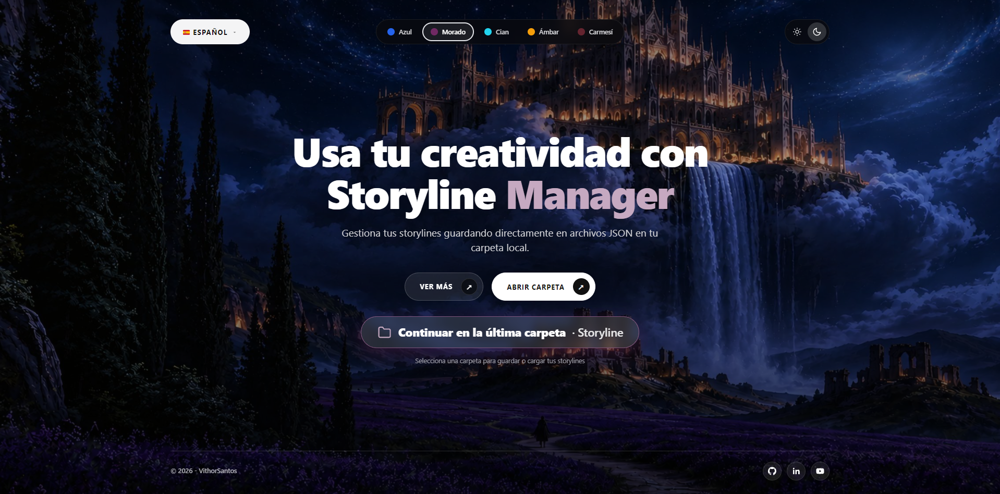
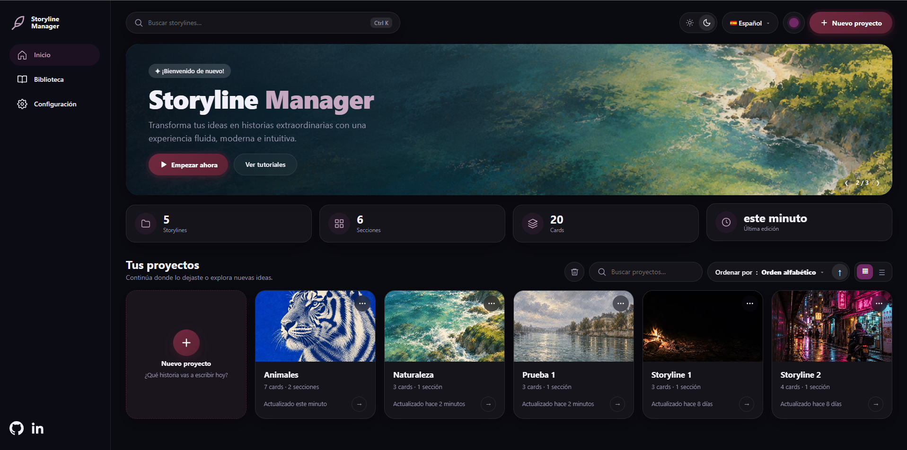
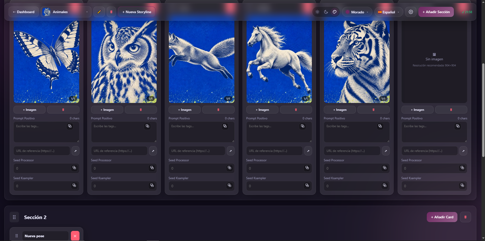
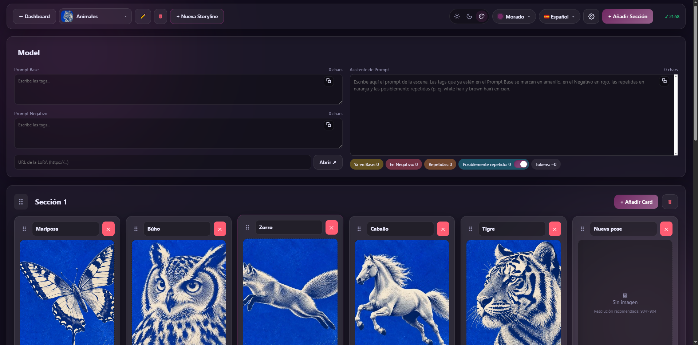

# Storyline Manager

[English](README.md) | [Português](README.pt-BR.md) | **Español**

Una aplicación web local para organizar **escenas y prompts de imagen** en flujos de trabajo de IA (Stable Diffusion, ComfyUI, Midjourney…). Crea storylines con secciones y cards, mantén juntos los prompts positivos/negativos y las imágenes de referencia, y guarda todo en **archivos JSON** sencillos dentro de una carpeta de tu ordenador.

Sin servidor, sin base de datos, sin cuenta: solo `index.html`, `style.css` y `app.js`.



## ✨ Funcionalidades

### Storylines
- Elige una carpeta una vez y trabaja directamente sobre sus archivos `.json` (lectura y escritura, mediante la File System Access API). Los archivos `.json` que no son storylines (sin la lista `sections`, como un `package.json`) se ignoran.
- Se recuerda la última carpeta usada: la próxima vez el selector de carpetas se abre en ella.
- Crea, renombra y elimina storylines desde el Panel o desde la cabecera del Workspace. Eliminar pide confirmación.
- **Configuración** (engranaje en la cabecera del Workspace y elemento en el menú lateral del panel): ventana con las pestañas *Guardado*, *Imágenes* y *Datos*. La primera vez que abres una carpeta aparece sola y hay que guardarla (los valores recomendados ya vienen marcados). Tus elecciones se guardan en el archivo `.storylines-settings.json` de la carpeta (con una copia en el navegador). Los cambios solo valen al pulsar **Guardar**; si sales con cambios pendientes, la app avisa.
- **Guardado automático** (activado por defecto): los cambios se escriben en la carpeta 3 segundos después de dejar de editar, al volver al panel, al cambiar/crear una storyline y al ocultar la pestaña. Mientras está activado, el botón *Guardar en la Carpeta* queda oculto y el estado muestra la hora del último guardado (o *Reintentar*, si falla). Para desactivarlo hay que confirmar un aviso. **Ctrl+S** guarda al instante.
- Protección contra pérdida de datos: con el guardado automático desactivado, al cambiar o crear una storyline con cambios pendientes puedes guardar, descartar o cancelar.
- **Imágenes más ligeras**: por defecto las imágenes subidas se convierten a **WebP** (calidad 90) y se reducen para caber en **904×904** (manteniendo la proporción, sin recortar ni ampliar). Puedes elegir WebP, PNG o JPEG, la calidad, otra resolución (predefinida o personalizada), ampliar imágenes menores o **mantener las imágenes originales**. Los GIF nunca se modifican. La conversión elimina los metadatos incrustados, como el workflow que ComfyUI escribe en los PNG, por eso hay un aviso y la opción de mantener los originales.
- **Convertir imágenes existentes** (pestaña *Datos*): aplica la configuración a las imágenes de todas las storylines, con resumen previo, confirmación, barra de progreso, botón cancelar y copia de seguridad opcional. La conversión no se puede deshacer.
- **Descargar imágenes** (pestaña *Datos*): genera un ZIP con todas las imágenes de una storyline, organizadas por sección y card, en el formato guardado o en PNG.

### Panel



- Queda entre la Home y el Workspace y se abre justo después de elegir la carpeta.
- Menú lateral con **Inicio**, **Biblioteca** (va directo a tus proyectos) y **Configuración**.
- Carrusel de imágenes con los botones **Empezar ahora** (crea una storyline) y **Ver tutoriales** (abre el canal de YouTube).
- Totales de la carpeta: storylines, secciones, cards y última edición.
- **Tus proyectos**: cada storyline se convierte en una tarjeta con portada opcional, cantidad de cards y secciones y fecha de la última edición. Tiene búsqueda (también desde el campo superior, con **Ctrl+K**), ordenación (alfabética, fecha de creación o última edición, ascendente o descendente) y vista en cuadrícula o en lista.
- **Nuevo proyecto** (botón superior o tarjeta **+**): pide el nombre y una portada opcional. Los errores de nombre aparecen dentro de la ventana, sin cerrarla.
- Menú **⋯** en cada tarjeta: editar el nombre y cambiar o quitar la portada.
- Botón de papelera junto a la búsqueda: selecciona una, varias o todas las storylines y elimínalas con confirmación.
- Arriba: claro/oscuro, idioma y color del tema.
- El panel guarda en tu carpeta un pequeño archivo `.storylines-index.json` (caché de conteos y fechas) para abrir rápido; puedes borrarlo sin problema.

### Workspace



- Donde editas la storyline abierta.
- Cabecera: **← Dashboard** (vuelve al panel), lista de storylines (portada, nombre, cards y secciones de cada una, con búsqueda cuando la carpeta tiene muchas), renombrar (✏️), eliminar (🗑), **+ Nueva Storyline**, fondo claro/oscuro/color del tema, color del tema, idioma, **Configuración** (⚙) y **+ Añadir Sección**.
- Con el guardado automático activado, la cabecera muestra la hora del último guardado; desactivado, aparece el botón **Guardar en la Carpeta**.



#### Sección Model
- Una sección **Model** fija permanece siempre arriba y no se puede mover ni eliminar.
- Guarda el **prompt base** y el **prompt negativo** del proyecto y una **URL de LoRA**, con un botón que abre el enlace en una pestaña nueva.
- Junto a esos campos hay un gran **Asistente de Prompt**: escribe ahí el prompt de la escena y marca las tags que ya están en el prompt base (amarillo), las del prompt negativo (rojo) y las repetidas dentro del propio texto (naranja). Las tags se comparan sin distinguir mayúsculas, pesos ni `_` de espacio, así que `no_humans` equivale a `no humans`. Un resumen también lista las tags que aparecen a la vez en el prompt base y en el negativo. La opción **Posiblemente repetido** (se activa o desactiva con ON/OFF) también señala tags de la misma categoría con colores distintos (respecto al prompt base y dentro del propio texto), como `white_hair` y `brown_hair` o `black shirt` y `white shirt` (cian). Las reglas de detección están en el `dictionary.js` editable (colores, alias, grupos de tags opuestas y una lista opcional `pairs` con pares de conflicto, `[["tag a", "tag b"]]`). Es un `.js`, y no un `.json`, para que también funcione al abrir `index.html` directamente desde el disco. Cuando la app se sirve desde `localhost`, también se lee un `cooccurrence.json` opcional (`{"pairs": [["tag a", "tag b"]]}`). El asistente también muestra una estimación de tokens.
- Cada nueva storyline nace con la sección Model y una sección normal con una card vacía.

#### Secciones y cards
- Las secciones tienen título editable, botón *Añadir Card* y botón de eliminar con confirmación.
- Cada card tiene título de la pose, **prompt positivo** (contador de caracteres en vivo y copia con un clic, con el aviso "¡Copiado!"), un botón de **URL de referencia** y dos campos de una línea: **Seed Processor** y **Seed Ksampler**.
- **Carrusel de imágenes** por card: sube varias imágenes a la vez, navega con las flechas y el indicador `1/3` y elimina la imagen activa.
- **Lightbox**: haz clic en una imagen para verla al tamaño real del archivo guardado, sin estirar ni encoger (por defecto, hasta 904×904).
- **Expansión de prompt**: haz doble clic en cualquier caja de prompt para editarla en una ventana grande.
- **Arrastrar y soltar** para reordenar secciones y cards (las cards también pueden pasar a otra sección). Al arrastrar una sección, todas se convierten en barras compactas para facilitar el encaje. La sección Model queda bloqueada arriba.

### Interfaz
- 5 temas simples (Azul, Morado, Cian, Ámbar y Carmesí). Cambiar el color cambia los acentos (la palabra "Manager" se anima en Home).
- **El modo oscuro es el predeterminado.** Un interruptor claro/oscuro está en Home (la imagen de fondo hace una transición suave entre la versión nocturna y la diurna), en el panel y en el Workspace. En el Workspace, el modo claro también aclara los contenedores, y una tercera opción usa el color del tema como fondo.
- Tres idiomas: 🇧🇷 Português, 🇺🇸 English y 🇪🇸 Español. El tema y el idioma están disponibles en Home, en el Panel y en el Workspace, y el navegador los recuerda.
- Adaptable desde 360 px de ancho: en el móvil, las cards se desplazan hacia el lado dentro de cada sección, y en móvil y tableta la cabecera queda arriba de la página y se convierte en una barra flotante compacta (lista de storylines, nueva storyline, añadir sección y guardar) al desplazarse. Animaciones suaves, respetando la preferencia de movimiento reducido.

## 🌐 Navegadores compatibles

| Navegador | Soporte |
|---|---|
| Google Chrome 86+ | ✅ Completo |
| Microsoft Edge 86+ | ✅ Completo |
| Firefox / Safari | ❌ No implementan `showDirectoryPicker`, que la app necesita para leer y escribir en tu carpeta |

## 🚀 Primeros pasos

Usa Chrome o Edge. Elige una opción:

**Opción 0 – Abrir directamente**
Haz doble clic en `index.html` (o arrástralo a Chrome/Edge). Todo funciona, incluido el Asistente de Prompt.

**Opción 1 – Live Server de VS Code**
1. Abre la carpeta del proyecto en VS Code.
2. Haz clic derecho en `index.html` → **Open with Live Server**.

**Opción 2 – Python**
```bash
python -m http.server 5500
```
Después abre <http://localhost:5500> en Chrome o Edge.

**Opción 3 – GitHub Pages**
Activa Pages en los ajustes del repositorio (rama `main`, carpeta raíz). Cada visitante elige una carpeta en su propio ordenador, así que sus datos nunca salen de su máquina.

## 📖 Uso

1. En Home, haz clic en **Selecciona una carpeta para guardar o cargar tus storylines** y elige una carpeta. Se abre el panel.
2. En el panel, haz clic en la tarjeta de una storyline para abrirla o crea una con **Nuevo proyecto** (con portada opcional). Usa la búsqueda y el menú de ordenación (alfabético, fecha de creación, última edición) para encontrar proyectos. Dentro del Workspace también puedes cambiar de storyline desde el desplegable de la cabecera.
3. Rellena la sección **Model**, añade secciones y cards, escribe tus prompts y añade imágenes.
4. Tus cambios se guardan automáticamente (consulta *Configuración*). Si desactivas el guardado automático, pulsa **Guardar en la Carpeta** (o Ctrl+S); el botón late mientras haya cambios sin guardar.

## 🗂️ Formato de los datos

Cada storyline es un archivo `.json`:

```json
{
  "createdAt": 1767225600000,
  "cover": "data:image/jpeg;base64,…",
  "model": { "prompt": "prompt base…", "negative": "…", "draft": "…", "lora": "https://…" },
  "sections": [
    {
      "id": "a1b2c3d",
      "title": "En el centro comercial",
      "cards": [
        {
          "id": "e4f5g6h",
          "title": "Pose 1",
          "url": "https://…",
          "positive": "…",
          "seedProcessor": "…",
          "seedKsampler": "…",
          "images": [{ "src": "data:image/png;base64,…" }]
        }
      ]
    }
  ]
}
```

`createdAt` y `cover` (portada opcional que se muestra en el panel, redimensionada a un máximo de 800 px) los escribe la app. Los archivos de versiones anteriores (sin `model`, `url`, `createdAt` ni `cover`) se abren con normalidad y se actualizan en el siguiente guardado.

## 📁 Estructura del proyecto

```
index.html   Marcado: Home, Panel, Workspace, modales, lightbox, expansión de prompt
style.css    Temas (variables CSS), diseño, animaciones, reglas responsivas
app.js       Estado, File System Access API, i18n, arrastrar y soltar, carrusel
dictionary.js     Diccionario editable del analizador
assets/      Imágenes de fondo (día/noche) y del carrusel (bg*.jpg, bg-night*.jpg, carousel-1..3.jpg)
```

## ⚠️ Notas y limitaciones

- **Las imágenes se guardan dentro del JSON** (en base64), por lo que los archivos pueden crecer mucho. Mantén activada la conversión a WebP/904 para reducir el tamaño; si eliges *Mantener imágenes originales*, redimensiona las imágenes antes de subirlas.
- **Eliminar una storyline es permanente**: el archivo se borra de la carpeta sin pasar por la papelera, porque el navegador no puede enviar archivos a la Papelera de reciclaje de Windows. La versión para Windows (.exe) debería usar la Papelera.
- El selector de carpetas del sistema solo muestra carpetas, así que una carpeta con archivos `.json` puede parecer vacía. Tras elegir la carpeta, la app muestra su nombre y cuántos `.json` encontró.
- Chrome bloquea algunas carpetas sensibles (como la raíz de Documentos o Descargas). Usa una subcarpeta, por ejemplo `Storylines`.
- Las banderas usan una pequeña fuente web cargada desde una CDN, porque Windows no dibuja los emojis de banderas. Sin conexión en Windows verás letras (BR, US, ES) en su lugar.

## 🗺️ Ideas para el futuro

- PWA instalable.
- Aplicación para Windows (.exe, con Electron), con las storylines eliminadas yendo a la Papelera de reciclaje de Windows.
- Imágenes guardadas como archivos separados junto al JSON.
- Sincronización opcional con la nube (Google Drive, Dropbox).

## 📄 Licencia

Uso gratuito bajo la [Storyline Manager Free Use License](LICENSE): puedes descargar y usar la app sin coste, pero no se permite copiar, modificar, publicar, distribuir, sublicenciar ni vender el software. Esta no es una licencia de código abierto.
