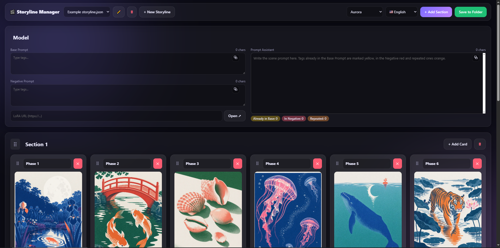
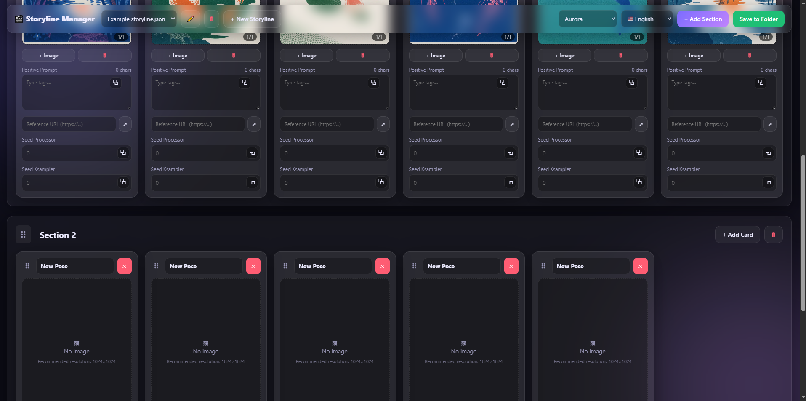

# 🎬 Storyline Manager

**English** | [Português](README.pt-BR.md) | [Español](README.es.md)

A local web app to organize **scenes and image prompts** for AI image workflows (Stable Diffusion, ComfyUI, Midjourney…). Build storylines made of sections and cards, keep your positive/negative prompts and reference images together, and save everything as plain **JSON files** in a folder on your computer.

No server, no database, no account: it is just `index.html`, `style.css` and `app.js`.




## ✨ Features

**Storylines**
- Pick a folder once and work directly on its `.json` files (read and write, via the File System Access API).
- The last folder you used is remembered: the folder picker opens right there next time.
- Create, rename (✏️) and delete (🗑) storylines from the header. Deleting asks for confirmation.
- Unsaved-changes protection: when you switch or create a storyline with pending edits, you can save, discard or cancel.

**Model section**
- A fixed **Model** section always stays on top and cannot be moved or deleted.
- It holds the project's **base prompt**, **negative prompt** and a **LoRA URL** with a button that opens it in a new tab.
- Next to those fields sits a large **Prompt Assistant**: write the scene prompt there and it highlights tags already in the base prompt (yellow), tags in the negative prompt (red) and tags repeated inside the text (orange). Tags are compared ignoring case, weights and the difference between `_` and spaces, so `no_humans` equals `no humans`. A summary also lists tags that appear in both the base and the negative prompt.
- Every new storyline starts with the Model section plus one regular section with an empty card.

**Sections and cards**
- Sections have editable titles, an *Add card* button and a delete button with confirmation.
- Each card has a pose title, a **positive prompt** (live character counter and one-click copy with a "Copied!" tooltip), a **reference URL** button, and two single-line fields: **Seed Processor** and **Seed Ksampler**.
- **Image carousel** per card: upload several images at once, browse with arrows and a `1/3` indicator, remove the active image.
- **Lightbox**: click an image to see it at its original resolution (recommended: 1024×1024).
- **Prompt expander**: double-click any prompt box to edit it in a large window.
- **Drag and drop** to reorder sections and cards (cards can also move between sections). While dragging a section, all sections collapse into compact bars to make dropping easy. The Model section is locked at the top.

**Interface**
- 10 themes: Aurora, Midnight Violet, Slate Minimal, Deep Emerald, Cyber Onyx, Obsidian Rose and four soft/pastel dark themes (Lavender, Mint, Peach, Sky).
- Three languages: 🇧🇷 Português, 🇺🇸 English and 🇪🇸 Español. Theme and language are available on both the Home and the Workspace screens and are remembered by the browser.
- Responsive down to 360 px wide: on phones, cards scroll sideways inside each section, and on phones and tablets the header stays at the top of the page and turns into a compact floating bar (storyline list, new storyline, add section, save) while you scroll. Smooth animations, reduced-motion friendly.

## 🌐 Browser support

| Browser | Support |
|---|---|
| Google Chrome 86+ | ✅ Full |
| Microsoft Edge 86+ | ✅ Full |
| Firefox / Safari | ❌ They do not implement `showDirectoryPicker`, which this app needs to read and write your folder |

## 🚀 Getting started

The app must be served from `localhost` or HTTPS so the browser exposes the File System Access API. Pick any option:

**Option 1 – VS Code Live Server**
1. Open the project folder in VS Code.
2. Right-click `index.html` → **Open with Live Server**.

**Option 2 – Python**
```bash
python -m http.server 5500
```
Then open <http://localhost:5500> in Chrome or Edge.

**Option 3 – GitHub Pages**
Enable Pages in the repository settings (branch `main`, root folder). Each visitor chooses a folder on their own computer, so their data never leaves their machine.

## 📖 Usage

1. On the Home screen, click **Select a folder to store or load your storylines** and choose a folder.
2. Pick an existing storyline in the header dropdown or click **+ New Storyline**.
3. Fill the **Model** section, add sections and cards, write your prompts and add images.
4. Click **Save to Folder**. The button pulses while there are unsaved changes.

## 🗂️ Data format

Each storyline is one `.json` file:

```json
{
  "model": { "prompt": "base prompt…", "negative": "…", "draft": "…", "lora": "https://…" },
  "sections": [
    {
      "id": "a1b2c3d",
      "title": "At the mall",
      "cards": [
        {
          "id": "e4f5g6h",
          "title": "Pose 1",
          "url": "https://…",
          "positive": "…",
          "seedProcessor": "…",
          "seedKsampler": "…",
          "images": [{ "src": "data:image/png;base64,…" }]
        }
      ]
    }
  ]
}
```

Files from older versions (without `model` or `url`) open normally and are upgraded on the next save.

## 📁 Project structure

```
index.html   Markup: Home, Workspace, modals, lightbox, prompt expander
style.css    Themes (CSS variables), layout, animations, responsive rules
app.js       State, File System Access API, i18n, drag and drop, carousel
```

## ⚠️ Notes and limitations

- **Images are stored inside the JSON** at their original resolution, so files can get large. Resize images to about 1024×1024 before uploading.
- **Deleting a storyline is permanent**: the file is removed from the folder without going through the recycle bin.
- The system folder picker only shows folders, so a folder with `.json` files can look empty. After you choose a folder, the app shows its name and how many `.json` files it found.
- Chrome blocks some sensitive folders (such as the root of Documents or Downloads). Use a subfolder, e.g. `Storylines`.
- Country flags use a small web font loaded from a CDN, because Windows does not draw flag emojis. Offline on Windows you will see letters (BR, US, ES) instead.

## 🗺️ Ideas for the future

- Installable PWA.
- Desktop app (Tauri or Electron) with direct file access and no browser restrictions.
- Images saved as separate files next to the JSON.
- Optional cloud sync (Google Drive, Dropbox).

## 📄 License

Free to use under the [Storyline Manager Free Use License](LICENSE): you may download and use the app at no cost, but copying, modifying, publishing, distributing, sublicensing or selling it is not permitted. This is not an open-source license.
