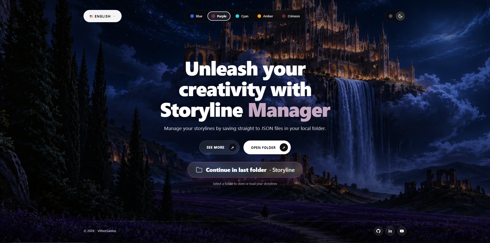
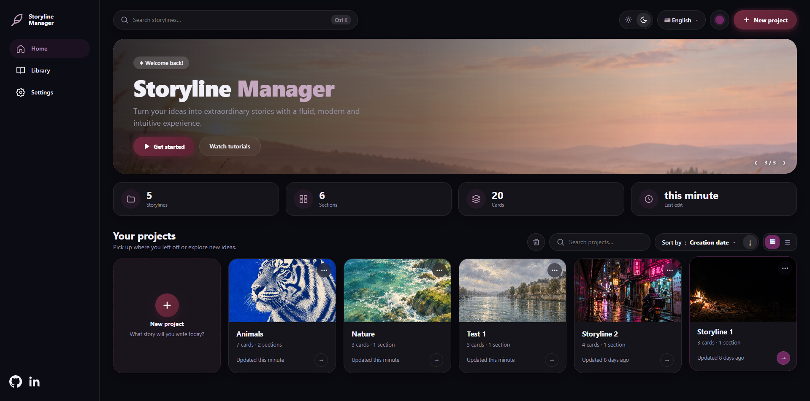
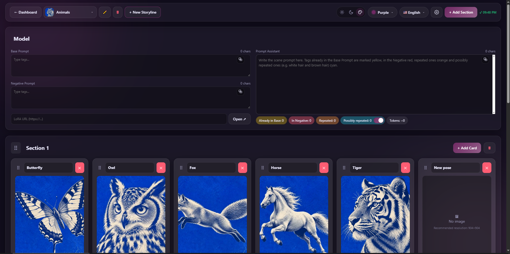
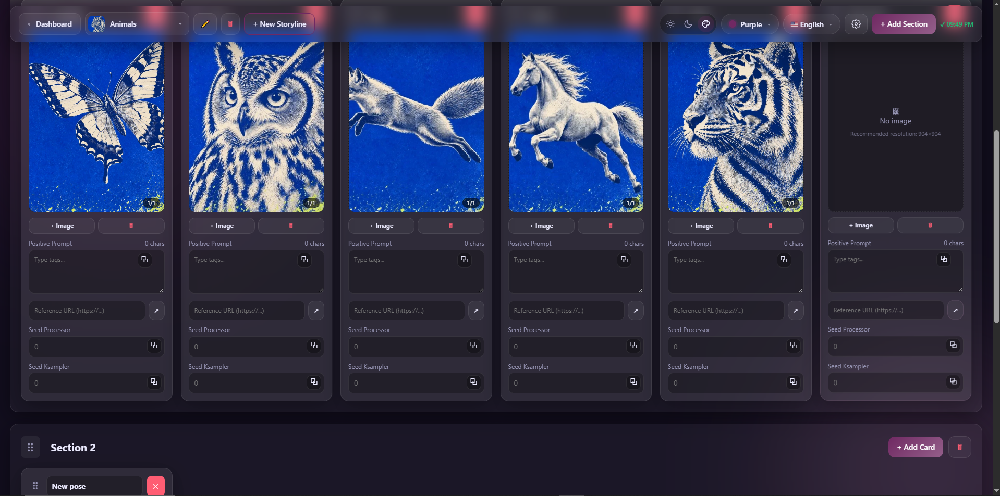

# Storyline Manager

**English** | [Português](README.pt-BR.md) | [Español](README.es.md)

A local web app to organize **scenes and image prompts** for AI image workflows (Stable Diffusion, ComfyUI, Midjourney…). Build storylines made of sections and cards, keep your positive/negative prompts and reference images together, and save everything as plain **JSON files** in a folder on your computer.

No server, no database, no account: it is just `index.html`, `style.css` and `app.js`.



## ✨ Features

### Storylines
- Pick a folder once and work directly on its `.json` files (read and write, via the File System Access API). `.json` files that are not storylines (no `sections` list, such as a `package.json`) are ignored.
- The last folder you used is remembered: the folder picker opens right there next time.
- Create, rename and delete storylines from the Dashboard or the Workspace header. Deleting asks for confirmation.
- **Settings** (gear in the Workspace header and an item in the dashboard side menu): a window with *Saving*, *Images* and *Data* tabs. The first time you open a folder it appears on its own and must be saved (the recommended values come pre-selected). Your choices are stored in the folder's `.storylines-settings.json` file (with a copy in the browser). Changes only apply when you click **Save**; leaving with pending changes shows a warning.
- **Autosave** (on by default): changes are written to the folder 3 seconds after you stop editing, when you go back to the dashboard, when you switch/create a storyline and when you hide the tab. While it is on, the *Save to Folder* button is hidden and the status shows the time of the last save (or *Try again* if it fails). Turning it off requires confirming a warning. **Ctrl+S** saves immediately.
- Unsaved-changes protection: with autosave off, switching or creating a storyline with pending edits lets you save, discard or cancel.
- **Lighter images**: by default uploaded images are converted to **WebP** (quality 90) and reduced to fit **904×904** (keeping the aspect ratio, no cropping, no upscaling). You can choose WebP, PNG or JPEG, the quality, another resolution (preset or custom), upscale smaller images, or **keep the original images**. GIFs are never changed. Conversion removes embedded metadata, such as the workflow ComfyUI writes into PNGs, so there is a warning and an option to keep the originals.
- **Convert existing images** (*Data* tab): applies the settings to the images of every storyline, with a preview summary, confirmation, progress bar, cancel button and optional backup. The conversion cannot be undone.
- **Download images** (*Data* tab): creates a ZIP with all the images of a storyline, organized by section and card, in the stored format or as PNG.

### Dashboard



- Sits between the Home and the Workspace and opens right after you choose the folder.
- Side menu with **Home**, **Library** (jumps straight to your projects) and **Settings**.
- Image carousel with the **Get started** (creates a storyline) and **Watch tutorials** (opens the YouTube channel) buttons.
- Folder totals: storylines, sections, cards and last edit.
- **Your projects**: each storyline becomes a card with an optional cover, its number of cards and sections and the last edit date. There is a search box (also through the top field, with **Ctrl+K**), sorting (alphabetical, creation date or last edit, ascending or descending) and a grid or list view.
- **New project** (top button or the **+** card): asks for a name and an optional cover. Name errors show inside the dialog without closing it.
- **⋯** menu on each card: edit the name and change or remove the cover.
- Trash button beside the search box: select one, several or all storylines and delete them with a confirmation.
- At the top: light/dark, language and theme color.
- The dashboard keeps a small `.storylines-index.json` file in your folder (a cache of counts and dates) so it opens fast; you can delete it safely.

### Workspace



- Where you edit the open storyline.
- Header: **← Dashboard** (back to the dashboard), storyline list (cover, name, cards and sections of each one, with a search box when the folder has many), rename (✏️), delete (🗑), **+ New Storyline**, light/dark/theme-color background, theme color, language, **Settings** (⚙) and **+ Add Section**.
- With autosave on, the header shows the time of the last save; with it off, the **Save to Folder** button appears.



#### Model section
- A fixed **Model** section always stays on top and cannot be moved or deleted.
- It holds the project's **base prompt**, **negative prompt** and a **LoRA URL** with a button that opens it in a new tab.
- Next to those fields sits a large **Prompt Assistant**: write the scene prompt there and it highlights tags already in the base prompt (yellow), tags in the negative prompt (red) and tags repeated inside the text (orange). Tags are compared ignoring case, weights and the difference between `_` and spaces, so `no_humans` equals `no humans`. A summary also lists tags that appear in both the base and the negative prompt. The **Possibly repeated** option (ON/OFF toggle) also flags tags of the same category with different colors (against the base prompt and within the text itself), such as `white_hair` and `brown_hair` or `black shirt` and `white shirt` (cyan). The detection rules live in the editable `dictionary.js` (colors, aliases, opposite-tag groups and an optional `pairs` list of conflict pairs, `[["tag a", "tag b"]]`). It is a `.js` file, not a `.json`, so it also works when you open `index.html` straight from disk. When the app is served from `localhost`, an optional `cooccurrence.json` (`{"pairs": [["tag a", "tag b"]]}`) is read too. The assistant also shows a token estimate.
- Every new storyline starts with the Model section plus one regular section with an empty card.

#### Sections and cards
- Sections have editable titles, an *Add card* button and a delete button with confirmation.
- Each card has a pose title, a **positive prompt** (live character counter and one-click copy with a "Copied!" tooltip), a **reference URL** button, and two single-line fields: **Seed Processor** and **Seed Ksampler**.
- **Image carousel** per card: upload several images at once, browse with arrows and a `1/3` indicator, remove the active image.
- **Lightbox**: click an image to see the saved file at its real size, without stretching or shrinking (by default, up to 904×904).
- **Prompt expander**: double-click any prompt box to edit it in a large window.
- **Drag and drop** to reorder sections and cards (cards can also move between sections). While dragging a section, all sections collapse into compact bars to make dropping easy. The Model section is locked at the top.

### Interface
- 5 simple themes (Blue, Purple, Cyan, Amber, Crimson). Changing the color re-colors the accents (the word "Manager" animates on the Home).
- **Dark mode is the default.** A light/dark switch sits on the Home (the background image cross-fades between the night and day versions), the dashboard and the Workspace. In the Workspace, light mode also makes the containers light, and a third option uses the theme color as the background.
- Three languages: 🇧🇷 Português, 🇺🇸 English and 🇪🇸 Español. Theme and language are available on the Home, Dashboard and Workspace screens and are remembered by the browser.
- Responsive down to 360 px wide: on phones, cards scroll sideways inside each section, and on phones and tablets the header stays at the top of the page and turns into a compact floating bar (storyline list, new storyline, add section, save) while you scroll. Smooth animations, reduced-motion friendly.

## 🌐 Browser support

| Browser | Support |
|---|---|
| Google Chrome 86+ | ✅ Full |
| Microsoft Edge 86+ | ✅ Full |
| Firefox / Safari | ❌ They do not implement `showDirectoryPicker`, which this app needs to read and write your folder |

## 🚀 Getting started

Use Chrome or Edge. Pick any option:

**Option 0 – Open directly**
Double-click `index.html` (or drag it into Chrome/Edge). Everything works, including the Prompt Assistant.

**Option 1 – VS Code Live Server**
1. Open the project folder in VS Code.
2. Right-click `index.html` → **Open with Live Server**.

**Option 2 – Python**
```bash
python -m http.server 5500
```
Then open <http://localhost:5500> in Chrome or Edge.

**Option 3 – GitHub Pages**
Enable Pages in the repository settings (branch `main`, root folder). Each visitor chooses a folder on their own computer, so their data never leaves their machine.

## 📖 Usage

1. On the Home screen, click **Select a folder to store or load your storylines** and choose a folder. The dashboard opens.
2. On the dashboard, click a storyline card to open it, or create one with **New project** (you can add an optional cover image). Use the search box and the sort menu (alphabetical, creation date, last edit) to find projects. Inside the Workspace you can also switch storylines from the header dropdown.
3. Fill the **Model** section, add sections and cards, write your prompts and add images.
4. Your changes are saved automatically (see *Settings*). If you turn autosave off, click **Save to Folder** (or press Ctrl+S); the button pulses while there are unsaved changes.

## 🗂️ Data format

Each storyline is one `.json` file:

```json
{
  "createdAt": 1767225600000,
  "cover": "data:image/jpeg;base64,…",
  "model": { "prompt": "base prompt…", "negative": "…", "draft": "…", "lora": "https://…" },
  "sections": [
    {
      "id": "a1b2c3d",
      "title": "At the mall",
      "cards": [
        {
          "id": "e4f5g6h",
          "title": "Pose 1",
          "url": "https://…",
          "positive": "…",
          "seedProcessor": "…",
          "seedKsampler": "…",
          "images": [{ "src": "data:image/png;base64,…" }]
        }
      ]
    }
  ]
}
```

`createdAt` and `cover` (optional cover image shown on the dashboard, resized to at most 800 px) are written by the app. Files from older versions (without `model`, `url`, `createdAt` or `cover`) open normally and are upgraded on the next save.

## 📁 Project structure

```
index.html   Markup: Home, Dashboard, Workspace, modals, lightbox, prompt expander
style.css    Themes (CSS variables), layout, animations, responsive rules
app.js       State, File System Access API, i18n, drag and drop, carousel
dictionary.js     Editable analyzer dictionary
assets/      Background (day/night) and carousel images (bg*.jpg, bg-night*.jpg, carousel-1..3.jpg)
```

## ⚠️ Notes and limitations

- **Images are stored inside the JSON** (as base64), so files can get large. Keep the WebP/904 conversion on to reduce the size; if you choose *Keep original images*, resize images before uploading.
- **Deleting a storyline is permanent**: the file is removed from the folder without going through the Recycle Bin, because the browser cannot send files to the Windows Recycle Bin. The Windows version (.exe) should use the Recycle Bin.
- The system folder picker only shows folders, so a folder with `.json` files can look empty. After you choose a folder, the app shows its name and how many `.json` files it found.
- Chrome blocks some sensitive folders (such as the root of Documents or Downloads). Use a subfolder, e.g. `Storylines`.
- Country flags use a small web font loaded from a CDN, because Windows does not draw flag emojis. Offline on Windows you will see letters (BR, US, ES) instead.

## 🗺️ Ideas for the future

- Installable PWA.
- Windows app (.exe, built with Electron), with deleted storylines going to the Windows Recycle Bin.
- Images saved as separate files next to the JSON.
- Optional cloud sync (Google Drive, Dropbox).

## 📄 License

Free to use under the [Storyline Manager Free Use License](LICENSE): you may download and use the app at no cost, but copying, modifying, publishing, distributing, sublicensing or selling it is not permitted. This is not an open-source license.
