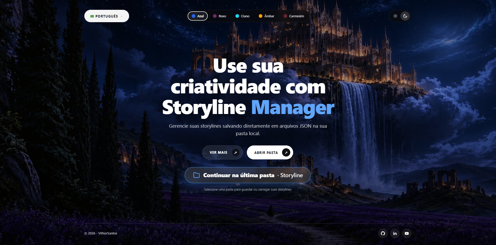
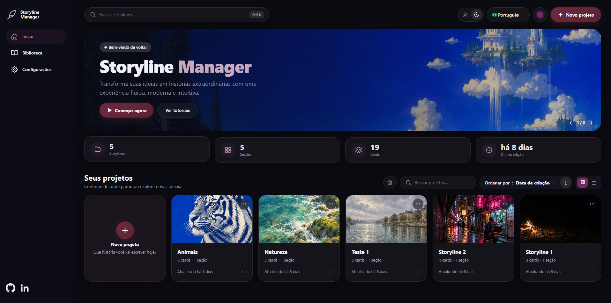
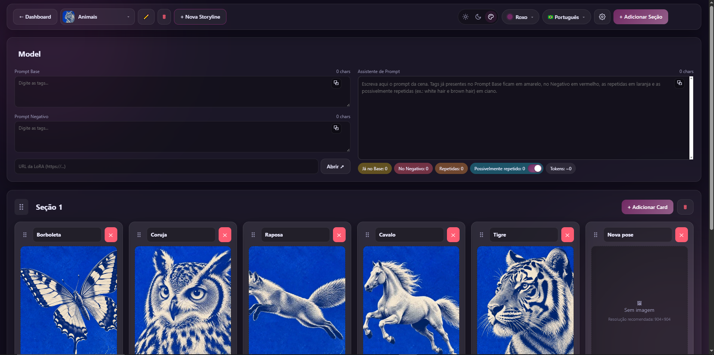
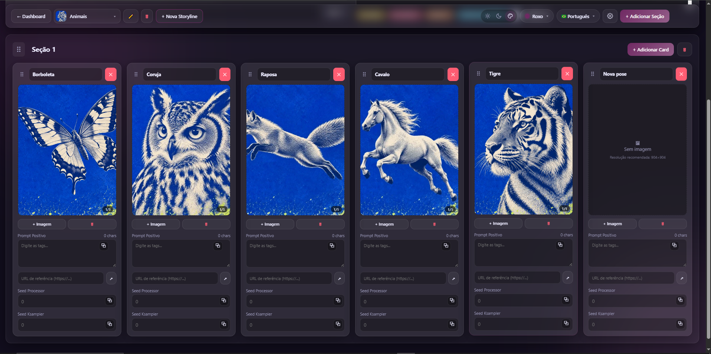

# Storyline Manager

[English](README.md) | **Português** | [Español](README.es.md)

Um aplicativo web local para organizar **cenas e prompts de imagem** em fluxos de IA (Stable Diffusion, ComfyUI, Midjourney…). Monte storylines com seções e cards, mantenha prompts positivos/negativos e imagens de referência juntos e salve tudo em **arquivos JSON** simples, em uma pasta do seu computador.

Sem servidor, sem banco de dados, sem conta: são só `index.html`, `style.css` e `app.js`.



## ✨ Funcionalidades

### Storylines
- Escolha uma pasta uma vez e trabalhe direto nos arquivos `.json` dela (leitura e escrita, pela File System Access API). Arquivos `.json` que não são storylines (sem a lista `sections`, como um `package.json`) são ignorados.
- A última pasta usada é lembrada: na próxima vez o seletor de pastas já abre nela.
- Crie, renomeie e exclua storylines pelo Painel ou pelo cabeçalho do Workspace. A exclusão pede confirmação.
- **Configurações** (engrenagem no cabeçalho do Workspace e item no menu lateral do painel): janela com abas *Salvamento*, *Imagens* e *Dados*. Na primeira vez que você abre uma pasta, ela aparece sozinha e precisa ser salva (os valores recomendados já vêm marcados). As escolhas ficam no arquivo `.storylines-settings.json` da pasta (com uma cópia no navegador). As mudanças só valem ao clicar em **Salvar**; ao sair com alterações pendentes o app avisa.
- **Salvamento automático** (ligado por padrão): as alterações são gravadas na pasta 3 segundos depois que você para de editar, ao voltar ao painel, ao trocar/criar storyline e ao ocultar a aba. Com ele ligado o botão *Salvar na Pasta* some e o status mostra a hora do último salvamento (ou *Tentar de novo*, se der erro). Para desligar é preciso confirmar um aviso. **Ctrl+S** salva na hora.
- Proteção contra perda de dados: com o salvamento automático desligado, ao trocar ou criar uma storyline com alterações pendentes você pode salvar, descartar ou cancelar.
- **Imagens mais leves**: por padrão as imagens enviadas são convertidas para **WebP** (qualidade 90) e reduzidas para caber em **904×904** (mantendo a proporção, sem cortar nem ampliar). Dá para escolher WebP, PNG ou JPEG, a qualidade, outra resolução (predefinida ou personalizada), ampliar imagens menores ou **manter as imagens originais**. GIFs nunca são alterados. A conversão remove metadados embutidos, como o workflow que o ComfyUI grava nos PNGs; por isso há um aviso e a opção de manter os originais.
- **Converter imagens existentes** (aba *Dados*): aplica as configurações às imagens de todas as storylines, com resumo prévio, confirmação, barra de progresso, botão cancelar e backup opcional. A conversão não pode ser desfeita.
- **Baixar imagens** (aba *Dados*): gera um ZIP com todas as imagens de uma storyline, organizadas por seção e card, no formato salvo ou em PNG.

### Painel



- Fica entre a Home e o Workspace e abre logo depois que você escolhe a pasta.
- Menu lateral com **Início**, **Biblioteca** (vai direto para os seus projetos) e **Configurações**.
- Carrossel de imagens com os botões **Começar agora** (cria uma storyline) e **Ver tutoriais** (abre o canal no YouTube).
- Totais da pasta: storylines, seções, cards e última edição.
- **Seus projetos**: cada storyline vira um card com capa opcional, quantidade de cards e seções e data da última edição. Tem busca (também pelo campo do topo, com **Ctrl+K**), ordenação (alfabética, data de criação ou última edição, em ordem crescente ou decrescente) e visualização em grade ou em lista.
- **Novo projeto** (botão do topo ou card **+**): pede o nome e uma capa opcional. Erros de nome aparecem dentro da janela, sem fechá-la.
- Menu **⋯** em cada card: editar o nome e trocar ou remover a capa.
- Botão de lixeira ao lado da busca: selecione uma, várias ou todas as storylines e exclua com confirmação.
- No topo: claro/escuro, idioma e cor do tema.
- O painel mantém na sua pasta um pequeno arquivo `.storylines-index.json` (cache de contagens e datas) para abrir rápido; pode apagá-lo sem problemas.

### Workspace



- Onde você edita a storyline aberta.
- Cabeçalho: **← Dashboard** (volta ao painel), lista de storylines (capa, nome, cards e seções de cada uma, com busca quando a pasta tem muitas), renomear (✏️), excluir (🗑), **+ Nova Storyline**, fundo claro/escuro/cor do tema, cor do tema, idioma, **Configurações** (⚙) e **+ Adicionar Seção**.
- Com o salvamento automático ligado, o cabeçalho mostra a hora do último salvamento; desligado, aparece o botão **Salvar na Pasta**.



#### Seção Model
- Uma seção **Model** fixa fica sempre no topo e não pode ser movida nem excluída.
- Ela guarda o **prompt base** e o **prompt negativo** do projeto e uma **URL de LoRA**, com um botão que abre o link em nova aba.
- Ao lado desses campos fica um grande **Assistente de Prompt**: escreva ali o prompt da cena e ele marca as tags que já estão no prompt base (amarelo), as que estão no prompt negativo (vermelho) e as repetidas dentro do próprio texto (laranja). As tags são comparadas sem diferenciar maiúsculas, pesos e `_` de espaço, então `no_humans` equivale a `no humans`. Um resumo também lista as tags que aparecem ao mesmo tempo no prompt base e no negativo. A opção **Possivelmente repetido** (liga/desliga com ON/OFF) também sinaliza tags da mesma categoria com cores diferentes (em relação ao prompt base e dentro do próprio texto), como `white_hair` e `brown_hair` ou `black shirt` e `white shirt` (ciano). As regras de detecção ficam no `dictionary.js` editável (cores, apelidos, grupos de tags opostas e uma lista opcional `pairs` com pares de conflito, `[["tag a", "tag b"]]`). Ele é um `.js`, e não um `.json`, para funcionar também ao abrir o `index.html` direto do disco. Quando o app é servido por `localhost`, um `cooccurrence.json` opcional (`{"pairs": [["tag a", "tag b"]]}`) também é lido. O assistente também mostra uma estimativa de tokens.
- Toda nova storyline já nasce com a seção Model e uma seção normal com um card vazio.

#### Seções e cards
- As seções têm título editável, botão *Adicionar Card* e botão de excluir com confirmação.
- Cada card tem título da pose, **prompt positivo** (contador de caracteres ao vivo e cópia com um clique, com o aviso "Copiado!"), um botão de **URL de referência** e dois campos de uma linha: **Seed Processor** e **Seed Ksampler**.
- **Carrossel de imagens** por card: envie várias imagens de uma vez, navegue com as setas e o indicador `1/3` e remova a imagem ativa.
- **Lightbox**: clique em uma imagem para vê-la no tamanho real do arquivo salvo, sem esticar nem encolher (por padrão, até 904×904).
- **Expansão de prompt**: dê dois cliques em qualquer caixa de prompt para editá-la em uma janela grande.
- **Arrastar e soltar** para reordenar seções e cards (os cards também podem ir para outra seção). Ao arrastar uma seção, todas viram barras compactas para facilitar o encaixe. A seção Model fica travada no topo.

### Interface
- 5 temas simples (Azul, Roxo, Ciano, Âmbar e Carmesim). Trocar a cor muda os destaques (a palavra "Manager" ganha uma animação na Home).
- **O modo escuro é o padrão.** Um interruptor claro/escuro fica na Home (a imagem de fundo faz uma transição suave entre a versão noturna e a diurna), no painel e no Workspace. No Workspace, o modo claro também deixa os containers claros, e uma terceira opção usa a cor do tema como fundo.
- Três idiomas: 🇧🇷 Português, 🇺🇸 English e 🇪🇸 Español. Tema e idioma ficam disponíveis na Home, no Painel e no Workspace e são lembrados pelo navegador.
- Responsivo a partir de 360 px de largura: no celular, os cards rolam para o lado dentro de cada seção, e no celular e no tablet o header fica no topo da página e vira uma barra flutuante compacta (lista de storylines, nova storyline, adicionar seção e salvar) ao rolar. Animações suaves, respeitando a preferência de movimento reduzido.

## 🌐 Navegadores compatíveis

| Navegador | Suporte |
|---|---|
| Google Chrome 86+ | ✅ Completo |
| Microsoft Edge 86+ | ✅ Completo |
| Firefox / Safari | ❌ Não implementam o `showDirectoryPicker`, que o app precisa para ler e gravar na sua pasta |

## 🚀 Como começar

Use o Chrome ou o Edge. Escolha uma opção:

**Opção 0 – Abrir direto**
Dê dois cliques no `index.html` (ou arraste-o para o Chrome/Edge). Tudo funciona, inclusive o Assistente de Prompt.

**Opção 1 – Live Server do VS Code**
1. Abra a pasta do projeto no VS Code.
2. Clique com o botão direito em `index.html` → **Open with Live Server**.

**Opção 2 – Python**
```bash
python -m http.server 5500
```
Depois abra <http://localhost:5500> no Chrome ou no Edge.

**Opção 3 – GitHub Pages**
Ative o Pages nas configurações do repositório (branch `main`, pasta raiz). Cada visitante escolhe uma pasta no próprio computador, então os dados nunca saem da máquina dele.

## 📖 Como usar

1. Na Home, clique em **Selecione uma pasta para guardar ou carregar suas storylines** e escolha uma pasta. O painel abre.
2. No painel, clique no card de uma storyline para abri-la ou crie uma em **Novo projeto** (com capa opcional). Use a busca e o menu de ordenação (alfabética, data de criação, última edição) para encontrar projetos. Dentro do Workspace você também troca de storyline pelo seletor do cabeçalho.
3. Preencha a seção **Model**, adicione seções e cards, escreva seus prompts e adicione imagens.
4. Suas alterações são salvas automaticamente (veja *Configurações*). Se desligar o salvamento automático, clique em **Salvar na Pasta** (ou Ctrl+S); o botão pulsa enquanto houver alterações não salvas.

## 🗂️ Formato dos dados

Cada storyline é um arquivo `.json`:

```json
{
  "createdAt": 1767225600000,
  "cover": "data:image/jpeg;base64,…",
  "model": { "prompt": "prompt base…", "negative": "…", "draft": "…", "lora": "https://…" },
  "sections": [
    {
      "id": "a1b2c3d",
      "title": "No shopping",
      "cards": [
        {
          "id": "e4f5g6h",
          "title": "Pose 1",
          "url": "https://…",
          "positive": "…",
          "seedProcessor": "…",
          "seedKsampler": "…",
          "images": [{ "src": "data:image/png;base64,…" }]
        }
      ]
    }
  ]
}
```

`createdAt` e `cover` (capa opcional exibida no painel, redimensionada para no máximo 800 px) são gravados pelo app. Arquivos de versões antigas (sem `model`, `url`, `createdAt` ou `cover`) abrem normalmente e são atualizados no próximo salvamento.

## 📁 Estrutura do projeto

```
index.html   Marcação: Home, Painel, Workspace, modais, lightbox, expansão de prompt
style.css    Temas (variáveis CSS), layout, animações, regras responsivas
app.js       Estado, File System Access API, i18n, arrastar e soltar, carrossel
dictionary.js     Dicionário editável do analisador
assets/      Imagens de fundo (dia/noite) e do carrossel (bg*.jpg, bg-night*.jpg, carousel-1..3.jpg)
```

## ⚠️ Observações e limitações

- **As imagens ficam dentro do JSON** (em base64), então os arquivos podem ficar grandes. Mantenha a conversão para WebP/904 ligada para reduzir o tamanho; se escolher *Manter imagens originais*, redimensione as imagens antes de enviar.
- **Excluir uma storyline é permanente**: o arquivo é removido da pasta sem passar pela lixeira, porque o navegador não permite enviar arquivos para a Lixeira do Windows. A versão para Windows (.exe) deve usar a Lixeira.
- O seletor de pastas do sistema mostra só pastas, então uma pasta com arquivos `.json` pode parecer vazia. Depois de escolher a pasta, o app mostra o nome dela e quantos `.json` encontrou.
- O Chrome bloqueia algumas pastas sensíveis (como a raiz de Documentos ou Downloads). Use uma subpasta, por exemplo `Storylines`.
- As bandeiras usam uma pequena fonte web carregada de uma CDN, porque o Windows não desenha emojis de bandeira. Sem internet no Windows, você verá letras (BR, US, ES) no lugar.

## 🗺️ Ideias para o futuro

- PWA instalável.
- Aplicativo para Windows (.exe, com Electron), com as storylines excluídas indo para a Lixeira do Windows.
- Imagens salvas como arquivos separados ao lado do JSON.
- Sincronização opcional com a nuvem (Google Drive, Dropbox).

## 📄 Licença

Uso gratuito sob a [Storyline Manager Free Use License](LICENSE): você pode baixar e usar o app sem custo, mas não é permitido copiar, modificar, publicar, distribuir, sublicenciar nem vender o software. Esta não é uma licença de código aberto.
